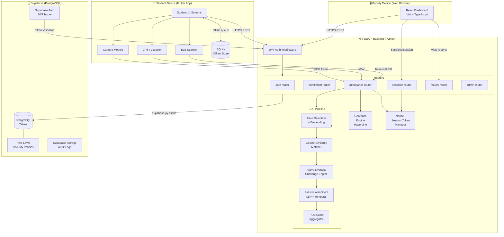
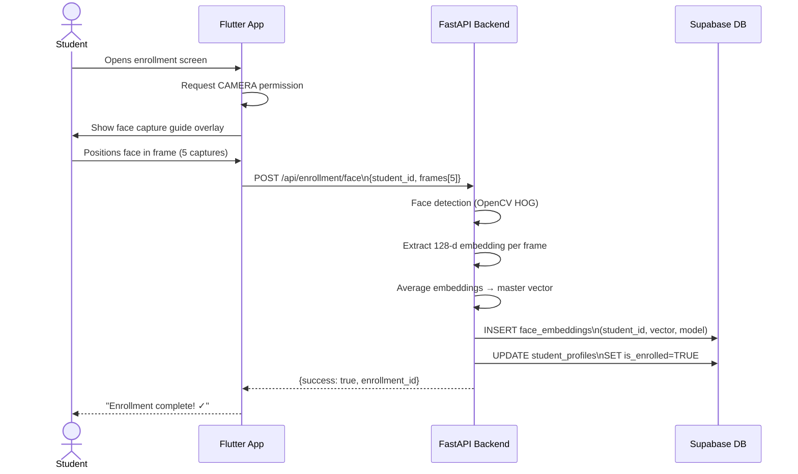
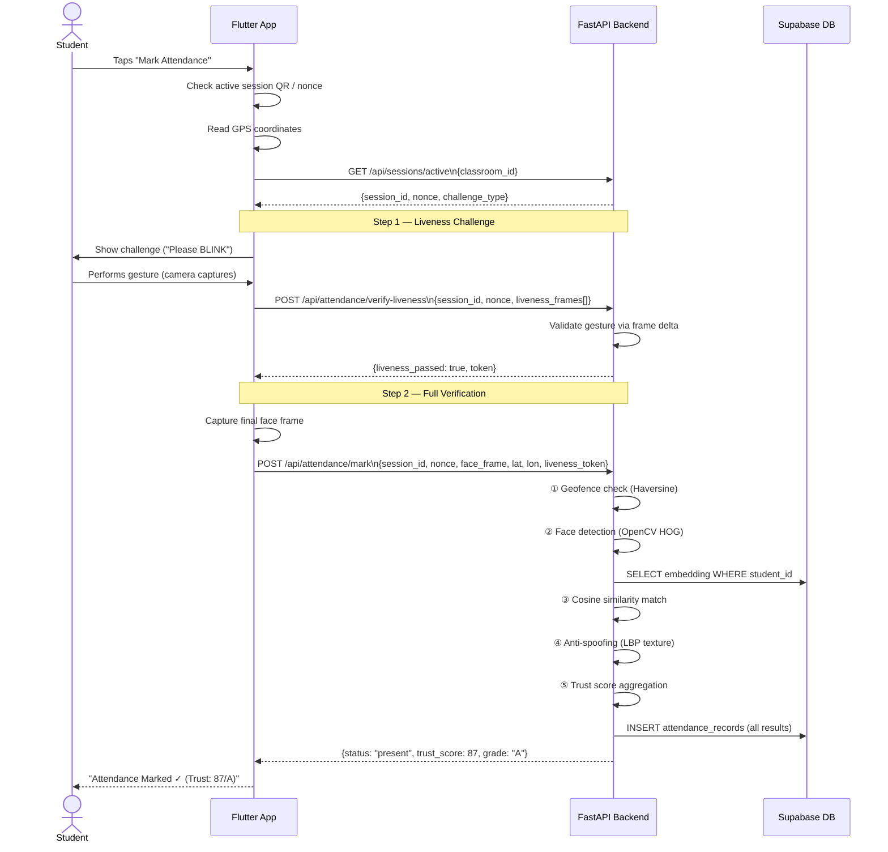

# AttendIQ — System Architecture

> **Tech Avinya Hackathon 2026 · CIH-001**

---

## High-Level System Diagram



---

## Component Descriptions

### 1. Flutter Mobile App (`mobile/`)

The student-facing application built with Flutter (Dart). It handles all three input channels for verification:

| Sub-component | File(s) | Responsibility |
|---------------|---------|---------------|
| Camera Service | `lib/services/camera_service.dart` | Captures frames for enrollment and attendance |
| Geolocation Service | `lib/services/location_service.dart` | Reads GPS coordinates, requests fine location permission |
| BLE Scanner | `lib/services/ble_service.dart` | Scans for classroom BLE beacon (enhancement layer) |
| Attendance API | `lib/services/attendance_api.dart` | Sends face frame + location to backend |
| Offline Queue | `lib/services/offline_queue.dart` | Queues attendance attempts when offline; syncs on reconnect |
| SQLite Store | `lib/services/local_db_service.dart` | Stores pending records using `sqflite` package |
| Liveness UI | `lib/screens/liveness_screen.dart` | Displays challenge prompt, animates countdown |
| Enrollment UI | `lib/screens/enrollment_screen.dart` | Multi-step face capture wizard |

### 2. FastAPI Backend (`backend/`)

The central processing unit. All verification logic lives here — the mobile app sends raw data, and the backend makes all trust decisions.

| Module | File | Responsibility |
|--------|------|---------------|
| Entry Point | `app/main.py` | CORS, rate limiting (SlowAPI), router mounting |
| Auth | `app/routers/auth.py` | Login, token refresh, role extraction |
| Enrollment | `app/routers/enrollment.py` | Face embedding extraction + storage |
| Sessions | `app/routers/sessions.py` | Faculty start/end session, QR + nonce generation |
| Attendance | `app/routers/attendance.py` | Orchestrates the full AI pipeline per attempt |
| Face Pipeline | `app/utils/face_pipeline.py` | HOG detection, embedding, cosine match |
| Liveness | `app/utils/liveness.py` | Challenge generation, response validation |
| Anti-Spoof | `app/utils/antispoof.py` | LBP texture, temporal frames, frequency |
| Geofence | `app/utils/geofence.py` | Haversine distance, radius check |
| Trust Score | `app/utils/trust_score.py` | Weighted score aggregation, grade assignment |

### 3. React Web Dashboard (`web/`)

Faculty and admin interface. Built with React 18, TypeScript, Vite, and Tailwind CSS.

| Page | Responsibility |
|------|---------------|
| `/login` | Auth form, JWT token stored in `localStorage` |
| `/dashboard` | Real-time attendance feed, session status |
| `/sessions` | Start/end sessions, generate QR codes |
| `/reports` | Attendance analytics, Recharts graphs |
| `/admin/students` | Student enrollment management |
| `/admin/classrooms` | Classroom coordinates + geofence config |
| `/admin/audit` | Suspicious attempt review, audit log |

### 4. Supabase (PostgreSQL + Auth + Storage)

Supabase serves as the backend-as-a-service layer providing:
- **PostgreSQL** — relational storage for all attendance data
- **Supabase Auth** — JWT issuance and user management
- **Row Level Security** — database-enforced access control
- **Storage buckets** — optional encrypted biometric data archival

---

## Data Flow: Student Enrollment



## Data Flow: Attendance Marking



---

## Security Architecture

```
┌─────────────────────────────────────────────────────────┐
│                    TRUST BOUNDARY                        │
│                                                          │
│  Student Device          FastAPI Backend                 │
│  ┌──────────────┐        ┌────────────────────────────┐ │
│  │ Flutter App  │        │ Auth Middleware             │ │
│  │              │ HTTPS  │  • JWT signature verify     │ │
│  │ No secrets   │◄──────►│  • Role extraction (RBAC)  │ │
│  │ stored       │        │  • Rate limiting (SlowAPI) │ │
│  │              │        │                            │ │
│  │ Face frames  │        │ Verification Pipeline      │ │
│  │ → NOT stored │        │  • Nonce replay prevention │ │
│  │   after send │        │  • Challenge expiry (90s)  │ │
│  └──────────────┘        │  • All checks server-side  │ │
│                          └────────────────────────────┘ │
│                                   │                      │
│                                   │ supabase-py          │
│                                   ▼                      │
│                          ┌────────────────────────────┐ │
│                          │ Supabase / PostgreSQL       │ │
│                          │  • RLS: students only see  │ │
│                          │    own records             │ │
│                          │  • Service key on server   │ │
│                          │  • Embeddings encrypted    │ │
│                          │    at rest (AES-256)       │ │
│                          └────────────────────────────┘ │
└─────────────────────────────────────────────────────────┘
```

**Key security principles:**
1. **No biometric data leaves the backend** — mobile app sends raw frames, not embeddings
2. **All verification decisions are server-side** — the app cannot self-approve attendance
3. **Nonce-based replay prevention** — each session has a unique nonce; re-use is rejected
4. **Short-lived challenges** — liveness challenges expire in 90 seconds
5. **RBAC enforced at API layer** — students cannot access faculty or admin routes
6. **RLS enforced at DB layer** — students cannot query other students' records

---

## API Communication Patterns

| Pattern | Usage |
|---------|-------|
| REST (JSON over HTTPS) | All mobile↔backend and web↔backend communication |
| JWT Bearer tokens | Included in `Authorization: Bearer <token>` header |
| Multipart form-data | Face frame image upload in enrollment/attendance |
| Supabase Realtime | Web dashboard subscribes to `attendance_records` table changes (live feed) |

---

## Offline Architecture

When the mobile device loses connectivity during an attendance attempt:

1. The Flutter app detects the network error from the Axios/Dio response
2. The attempt is serialized to **SQLite** via `sqflite` (`lib/services/local_db_service.dart`)
3. A background sync service (`lib/services/offline_queue.dart`) monitors connectivity
4. On reconnection, queued attempts are replayed to the backend **in order**
5. The backend validates nonce freshness; expired attempts (>5 minutes) are rejected with `NONCE_EXPIRED`
6. A visual badge on the student home screen shows the pending queue count

> **Limitation:** Offline attendance is only valid if the nonce has not expired. Prolonged offline periods (>5 min) will cause rejection on sync.

---

## AI Pipeline Overview

```
Frame Input (JPEG from camera)
        │
        ▼
┌───────────────┐
│  Face Detect  │  OpenCV HOG → bounding box
└──────┬────────┘
       │
       ▼
┌───────────────┐
│  Embedding    │  128-dim vector (HOG/InsightFace)
└──────┬────────┘
       │
       ▼
┌───────────────┐
│  Face Match   │  Cosine similarity vs. enrolled vector
└──────┬────────┘
       │
       ▼
┌───────────────┐
│  Liveness     │  Challenge-response (blink/nod/smile)
└──────┬────────┘
       │
       ▼
┌───────────────┐
│  Anti-Spoof   │  LBP texture + temporal + frequency
└──────┬────────┘
       │
       ▼
┌───────────────┐
│  Trust Score  │  Weighted aggregation → 0-100, grade A-F
└──────┬────────┘
       │
       ▼
  PRESENT / ABSENT / SUSPICIOUS
```

See [`AI_PIPELINE.md`](AI_PIPELINE.md) for the full technical deep dive.
